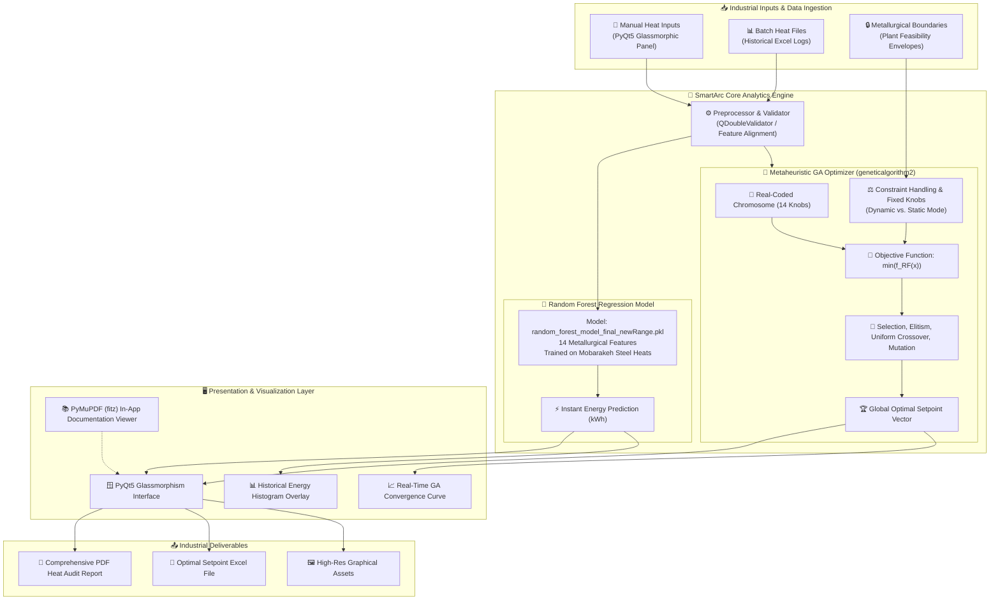

<div align="center">


<br/>

[](https://www.python.org/)
[](https://riverbankcomputing.com/software/pyqt/)
[](https://scikit-learn.org/)
[](https://github.com/P胜)
[](LICENSE)
[](#)

<p align="center">
  <b>⚡ AI-Driven Energy Prediction & Metaheuristic Genetic Algorithm Optimization for Electric Arc Furnace (EAF) Steelmaking Plants ⚡</b>
</p>

<p align="center">
  <a href="#-key-highlights">🌟 Highlights</a> •
  <a href="#-system-architecture">🏗️ Architecture</a> •
  <a href="#-metallurgical-parameters">🧪 Metallurgical Variables</a> •
  <a href="#-mathematical-formulation">📐 Mathematical Model</a> •
  <a href="#-gui-showcase--workflow">🖥️ User Interface</a> •
  <a href="#-quickstart--installation">🚀 Quickstart</a> •
  <a href="#-building-standalone-executable">📦 Compilation</a>
</p>

---

</div>

## 📌 Executive Overview

In modern electric arc furnace (EAF) steelmaking facilities, electrical energy represents one of the single highest operational expenditures and carbon footprint drivers, with industrial furnaces consuming between **350 to 550 kWh per ton** of liquid steel across hundreds of metric tons per heat.

**SmartArc (RoudAi-SmartArc)** is an enterprise-grade artificial intelligence and metaheuristic decision-support platform designed specifically for meltshop engineers, furnace operators, and metallurgical data scientists. By coupling high-fidelity **Random Forest Ensemble Machine Learning** trained on verified industrial heats (Mobarakeh Steel Company) with an adaptive **Real-Coded Genetic Algorithm (GA)**, SmartArc:

1. ⚡ **Accurately forecasts** total electrical energy consumption ($E_{\text{tot}}$ in $\text{kWh}$) before and during arc furnace heats.
2. 🧬 **Discovers optimal operating setpoints** that minimize total electrical power while adhering strictly to physical, thermal, and chemical plant constraints.
3. 🎛️ **Supports flexible operational modes** (Dynamic full-space search vs. Static constrained mode for locking fixed charges like Scrap/DRI or tapping goals).
4. 🪟 **Delivers an ultra-modern desktop experience** featuring a dark glassmorphism GUI, animated splash screens, integrated high-DPI document readers, and automated PDF/Excel engineering reporting.

---

## 🌟 Key Highlights

<table>
  <tr>
    <td width="50%">
      <h3 align="center">🔮 Real-Time Machine Learning Inference</h3>
      <p>
        Instant multi-variable predictive modeling powered by a tuned <b>Random Forest Regressor</b>. Evaluates 14 interrelated metallurgical inputs (temperatures, scrap &amp; DRI mix, lance graphite, chemical fluxes, oxygen, and methane gas) with sub-second latency.
      </p>
    </td>
    <td width="50%">
      <h3 align="center">🧬 Metaheuristic Genetic Optimization</h3>
      <p>
        Multi-dimensional chromosome optimization utilizing <b>geneticalgorithm2</b> with real-coded variables, uniform crossover, dynamic mutation, and elitism selection. Solves non-linear, non-convex energy landscapes within metallurgical feasibility bounds.
      </p>
    </td>
  </tr>
  <tr>
    <td width="50%">
      <h3 align="center">🎛️ Dual-Mode Optimization Engine</h3>
      <p>
        <b>Dynamic Mode:</b> Global exploration across all metallurgical dimensions.<br/>
        <b>Static Mode:</b> Selectively locks immutable constraints (e.g., cold scrap weight, heel status, target tap temperature) while optimizing flexible chemical energy additions (O₂, Lime, Methane, Coke).
      </p>
    </td>
    <td width="50%">
      <h3 align="center">🪟 Ultra-Modern Glassmorphism UI</h3>
      <p>
        Crafted in <b>PyQt5</b> with a sleek dark-slate palette (<code>#0F172A</code>), translucent acrylic containers, backdrop blur, custom floating-point validators, responsive layout containers, and smooth animation transitions.
      </p>
    </td>
  </tr>
  <tr>
    <td width="50%">
      <h3 align="center">📊 Dynamic Visualization &amp; Analytics</h3>
      <p>
        Integrated <b>Matplotlib</b> visualizer embedded directly into Qt layouts: live GA generation fitness convergence curves, historical energy distribution histograms with user-point overlays, and feature importance rankings.
      </p>
    </td>
    <td width="50%">
      <h3 align="center">📄 Industrial Automated Reporting</h3>
      <p>
        Export complete engineering dossiers in one click: multi-page <b>PDF Reports</b> with embedded high-resolution vector graphs and tabular inputs, <b>PNG chart exports</b>, and <b>Excel spreadsheets</b> ready for furnace automation systems.
      </p>
    </td>
  </tr>
</table>

---

## 🏗️ System Architecture

The following diagram illustrates the end-to-end data processing, intelligence engine, and user interaction loop of SmartArc:



---

## 🧪 Metallurgical Parameters & Feasibility Envelopes

SmartArc manages **14 key metallurgical variables** governing the chemical, thermal, and electrical balance of an Electric Arc Furnace heat:

| # | Feature Code | UI Display Label | Unit | Operational Range | Metallurgical Role & Control Mechanism |
|---|---|---|:---:|:---:|---|
| **1** | `HEEL_NO` | `HEEL NO` | binary | `[0, 1]` | Hot metal liquid heel retention from previous tap (0 = Cold start, 1 = Hot heel). |
| **2** | `GRAPHIT_LANCE_EAF` | `GRAPHIT LANCE` | $\text{kg}$ | `[0.0, 1500.0]` | Graphite lance consumption for foaming slag generation and bath recarburization. |
| **3** | `TAP_TO_TAP_SS` | `TAP TO TAP START` | $\text{s}$ | `[3601.0, 6598.0]` | Total cycle time from prior tap to subsequent tap start; dictates radiation & standby losses. |
| **4** | `TAP_WEI_TON` | `TAP WEI` | $\text{ton}$ | `[180.0, 200.0]` | Total tapped liquid crude steel weight delivered into the ladle. |
| **5** | `TAP_TEMP_EAF` | `TAP TEMP` | $^\circ\text{C}$ | `[1577.0, 1660.0]` | Liquid steel bath temperature at tap end; direct indicator of thermal sensible heat. |
| **6** | `FIRST_TEMP_EAF` | `FIRST TEMP` | $^\circ\text{C}$ | `[1560.0, 1670.0]` | First immersion thermocouple measurement after initial melt-down. |
| **7** | `SCRAP_WEI_EAF` | `SCRAPE` | $\text{kg}$ | `[0.0, 60000.0]` | Heavy/shredded scrap charge charged via basket (adjusted to 40-60t if Heel=0). |
| **8** | `DRI_EAF` | `DRI` | $\text{ton}$ | `[180.0, 250.0]` | Direct Reduced Iron (sponge iron) continuously fed through the furnace roof. |
| **9** | `POWER_ON_TAP` | `POWER ON TAP` | $\text{s}$ | `[3000.0, 4500.0]` | Total active electric arc arcing duration (transformer power-on time). |
| **10** | `OXCYGEN_EAF` | `OXCYGEN` | $\text{Nm}^3$ | `[4531.0, 7960.0]` | Gaseous oxygen injected through coherent jet burners for exothermic chemical oxidation. |
| **11** | `LIME_EAF` | `LIME` | $\text{kg}$ | `[6010.0, 11794.4]` | High-calcium burnt lime ($\text{CaO}$) for slag basicity ($\text{V-ratio}$) and dephosphorization. |
| **12** | `DOLOMIT_LIME_EAF` | `LIME DOLOMIT` | $\text{kg}$ | `[5000.0, 9000.0]` | Dolomitic lime ($\text{MgO}$-saturated) for refractory lining preservation and foaming. |
| **13** | `COFE_COKE_EAF` | `COFE COKE` | $\text{kg}$ | `[0.0, 1000.0]` | Anthracite / carbon injection for slag foaming, CO combustion, and bath reduction. |
| **14** | `GAS_MEATN_EAF` | `GAS MEATN` | $\text{Nm}^3$ | `[400.0, 800.0]` | Natural gas ($\text{CH}_4$) supplied to wall burners during scrap melting stages. |
| **🎯** | `ENERGY_TOT_EAF` | **TOTAL ENERGY** | $\text{kWh}$ | *Output Target* | Total active electrical energy consumed by the primary furnace transformer. |

---

## 📐 Mathematical Model & Genetic Algorithm

### 1. The Energy Minimization Problem
The objective is to find an optimal parameter vector $\mathbf{x}^* \in \mathbb{R}^{14}$ within bounded operating domain $\Omega$:

$$\min_{\mathbf{x}} \quad \mathcal{J}(\mathbf{x}) = f_{\text{RF}}(\mathbf{x})$$

Subject to:

$$l_i \le x_i \le u_i \quad \forall i \in \{1, 2, \dots, 14\}$$

$$x_j = c_j \quad \forall j \in \mathcal{S}_{\text{static}}$$

Where:
- $f_{\text{RF}}(\mathbf{x})$ is the trained non-linear Random Forest surrogate evaluation function.
- $[l_i, u_i]$ denotes the metallurgical feasibility boundary for variable $i$.
- $\mathcal{S}_{\text{static}}$ is the set of user-locked parameters in **Static Mode** (holding specific variables constant while optimizing remaining degrees of freedom).

### 2. Heel & Scrap Coupling Rule
Metallurgically, if no hot heel is retained (`HEEL_NO = 0`), a heavy initial scrap charge is required to protect bottom refractories:

$$\text{If } x_{\text{HEEL\_NO}} = 0 \implies x_{\text{SCRAP\_WEI}} \in [40000, 60000] \text{ kg}$$

$$\text{If } x_{\text{HEEL\_NO}} = 1 \implies x_{\text{SCRAP\_WEI}} \in [0, 0] \text{ kg (100\% DRI continuous feed)}$$

### 3. Genetic Algorithm Hyperparameters

| Hyperparameter | Value | Description |
|---|:---:|---|
| **Population Size** ($N_p$) | `100` | Number of simultaneous candidate heats evaluated per generation |
| **Max Iterations** ($G_{\max}$) | `20 - 100` | Configurable generational stopping criterion |
| **Crossover Operator** | `Uniform` | Uniform recombination across real-coded chromosomes |
| **Crossover Ratio** | `0.70` | Proportion of offspring generated via crossover |
| **Mutation Probability** ($p_m$) | `0.20` | Dynamic gaussian perturbation rate for diversity preservation |
| **Elitism Ratio** | `0.01` | Top-performing elite individuals preserved without alteration |
| **Parents Selection** | `0.30` | Top 30% parent ranking pool |

---

## 🖥️ GUI Showcase & Workflow

SmartArc is designed for high-intensity industrial control environments:

<details open>
<summary><b>1. ⚡ Real-Time Heat Prediction Workflow</b></summary>
<br/>

1. Enter or adjust current heat setpoints in the **Inputs** panel (each input has strict color-coded boundary feedback).
2. Click **Run Prediction**:
   - The Random Forest model executes inference instantly.
   - The result appears in the prediction badge (e.g. `Predicted: 92,450 KWh`).
   - The **Historical Energy Distribution Histogram** updates with a vertical line marking where the current heat stands compared to thousands of real heats.
3. Click **Download PDF** or **Download PNG** to generate a documented audit of this prediction.
</details>

<details>
<summary><b>2. 🧬 Metaheuristic Energy Optimization Workflow</b></summary>
<br/>

1. Select desired iteration budget in the **GA AI NUM. (Max Num Iteration)** field (range 20 to 100).
2. Choose your optimization strategy:
   - **Dynamic Mode (Default):** SmartArc searches all 14 dimensions to discover the absolute minimum energy heat configuration.
   - **Static Mode:** Check the **Static Mode** box. Checkboxes appear beside each input. Lock specific variables (e.g., lock Scrap Weight, DRI Weight, and Tapping Temperature) while allowing the algorithm to optimize chemical injection (Oxygen, Gas, Lime, Coke).
3. Click **Run Optimization**:
   - A multi-threaded background worker (`OptimizeWorker`) spawns to keep the UI smooth and responsive.
   - The **Real-Time GA Convergence Plot** updates live as fitness improves generation by generation.
   - The optimized global minimum is displayed (e.g., `Optimized Energy: 81,230 KWh`).
4. Click **Export Excel (Optimized)** to export the complete optimized parameter row for PLC/SCADA transmission.
</details>

<details>
<summary><b>3. 📚 In-App Metallurgical Knowledge Base</b></summary>
<br/>

- SmartArc includes a high-DPI document viewer window built with **PyMuPDF (`fitz`)**.
- Click **Program Help** to browse embedded manuals, process balance formulas, and metallurgical carbon-control procedures directly without leaving the app.
</details>

---

## 🚀 Quickstart & Installation

### Prerequisites
- **Operating System:** Windows 10 / 11, Linux, or macOS
- **Python:** Python 3.9, 3.10, or 3.11 (64-bit recommended)
- **Git**

### Step-by-Step Setup

```bash
# 1. Clone the repository
git clone https://github.com/Essi2030/RoudAi-SmartArc.git
cd RoudAi-SmartArc

# 2. Create and activate a Python virtual environment
python -m venv .venv

# On Windows (PowerShell):
.venv\Scripts\Activate.ps1
# On Windows (cmd):
.venv\Scripts\activate.bat
# On Linux / macOS:
source .venv/bin/activate

# 3. Upgrade pip and install required dependencies
pip install --upgrade pip
pip install -r requirements.txt
```

### Launching the Application

```bash
# Launch SmartArc GUI
python v2.py
```

---

## 📦 Building Standalone Executable

SmartArc includes a production-ready **PyInstaller specification** (`SmartArc.spec`) to build a single standalone Windows executable (`SmartArc.exe`):

```bash
# Compile using PyInstaller and the provided spec file
pyinstaller --clean SmartArc.spec
```

The resulting standalone executable will be generated inside the `dist/` directory:
- Contains all required machine learning models (`random_forest_model_final_newRange.pkl`), datasets, icons, and PDF viewers.
- Runs on any standard Windows 64-bit machine without requiring Python to be installed.

---

## 📂 Project Structure

```plaintext
d:/eaf_ai/
├── assets/
│   └── banner.svg                             # Animated SVG repository header banner
├── Datas/
│   ├── Help.xlsx                              # Template input spreadsheet for batch evaluations
│   ├── app_data.bak                           # Serialized heat database for baseline distribution
│   ├── core.png                               # High-res furnace background graphics
│   ├── help2.pdf                              # Metallurgical guidance documentation
│   └── ic.ico                                 # Application icon resource
├── doc/                                       # Project documentation & reference sheets
├── GA_RF_Energy_Final.py                      # Standalone GA optimization script & CLI harness
├── RF_Energy_Final.py                         # Standalone Random Forest training & validation script
├── check_model.py                             # Verification script for model features & data alignment
├── optimize_worker_patch.py                   # Multi-threaded PyQt5 worker patch
├── SmartArc.spec                              # Production PyInstaller build configuration
├── v2.py                                      # 🚀 Main SmartArc Application (PyQt5 GUI + ML + GA)
├── random_forest_model_final_newRange.pkl     # Pre-trained Random Forest model weights (55.8 MB)
├── app_data.bak                               # Active operational dataset
├── Help.xlsx                                  # Example dataset for operator guidance
├── help.pdf                                   # Metallurgical manual & help document
├── Energy Balance.pdf                         # Theoretical EAF energy balance reference
├── دستور العمل کنترل کربن.pdf                 # Carbon control instructions (Farsi)
├── دامنه واقعی داده ها.pdf                    # Industrial parameter validity boundaries
├── core.png                                   # UI glassmorphism texture backdrop
├── smartarc.ico                               # Windows window & taskbar icon
├── smartarc_icon.png                          # PNG icon resource
├── requirements.txt                           # Python package dependencies
├── setup.py                                   # Package installer script
└── .gitignore                                 # Git ignore rules for build & environment files
```

---

## 🧰 Technology Stack

- **GUI Framework:** [PyQt5](https://riverbankcomputing.com/software/pyqt/) with QtGraphics blur effects and custom stylesheets.
- **Machine Learning:** [scikit-learn](https://scikit-learn.org/) (`RandomForestRegressor`, `train_test_split`).
- **Optimization:** [geneticalgorithm2](https://pypi.org/project/geneticalgorithm2/) for metaheuristic evolutionary search.
- **Data Engineering:** [Pandas](https://pandas.pydata.org/), [NumPy](https://numpy.org/), [OpenPyXL](https://openpyxl.readthedocs.io/).
- **Scientific Plotting:** [Matplotlib](https://matplotlib.org/) (`FigureCanvasQTAgg`, `PdfPages`).
- **Document Rendering:** [PyMuPDF](https://pymupdf.readthedocs.io/) (`fitz`) for native multi-page PDF viewing.
- **Packaging:** [PyInstaller](https://pyinstaller.org/) for standalone zero-dependency distribution.

---

## 🤝 Contributing

Contributions, feedback, and industrial feature requests are welcome!
1. Fork the Project (`https://github.com/Essi2030/RoudAi-SmartArc/fork`)
2. Create your Feature Branch (`git checkout -b feature/AdvancedFoamingOptimization`)
3. Commit your Changes (`git commit -m 'feat: Add slag foaming index constraint'`)
4. Push to the Branch (`git push origin feature/AdvancedFoamingOptimization`)
5. Open a Pull Request

---

## 📜 License & Acknowledgments

This project is licensed under the **MIT License** - see the [LICENSE](LICENSE) file for details.

### Acknowledgments
- **Mobarakeh Steel Company (MSC):** For industrial EAF heat data logs and empirical metallurgical validation.
- **RoudAi Team:** For architectural design, machine learning pipelines, and optimization algorithms.
- **Industry 4.0 Steelmaking Community:** Dedicated to sustainable, energy-efficient, and decarbonized metallurgical operations worldwide.

---

<div align="center">
  <sub>Developed with ⚡ by <a href="https://github.com/Essi2030">Essi2030</a> &amp; the RoudAi Team. Transforming steel manufacturing with Artificial Intelligence.</sub>
</div>
